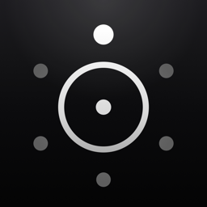
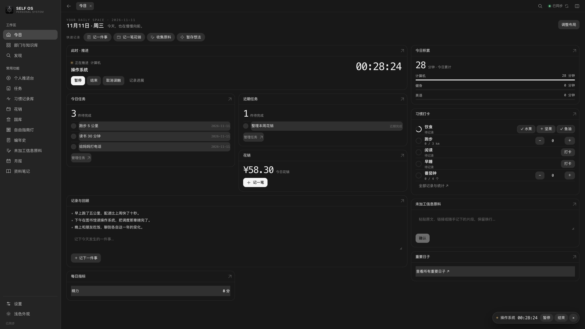
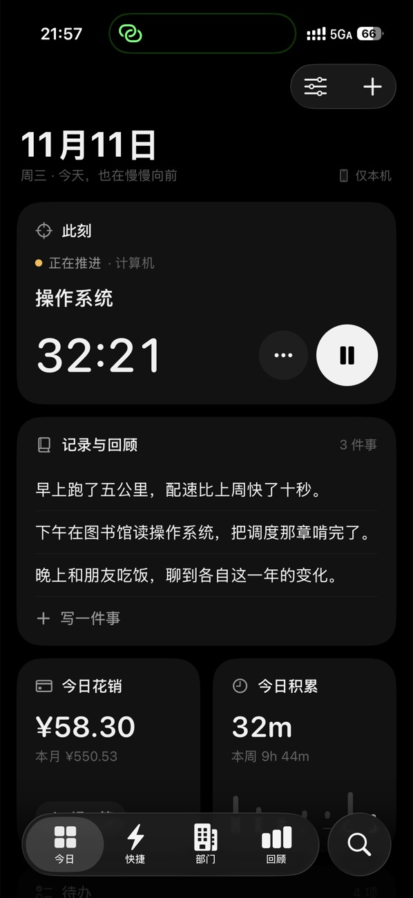
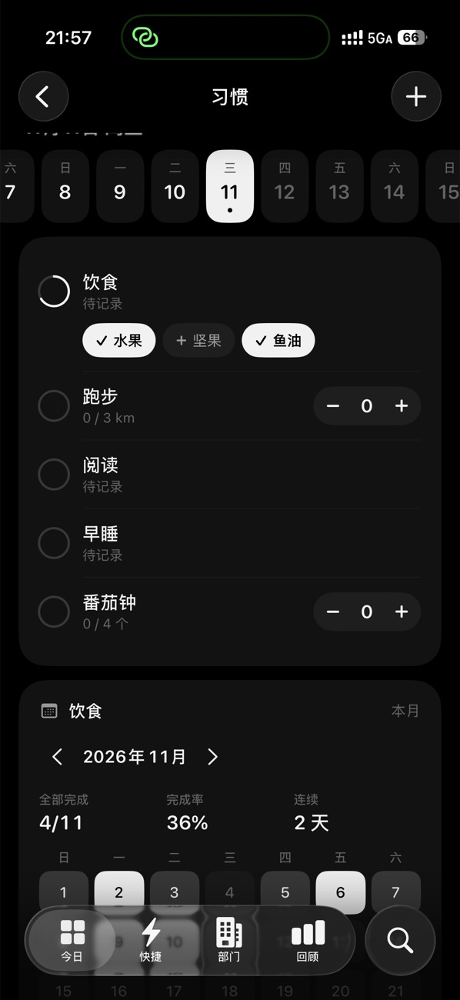
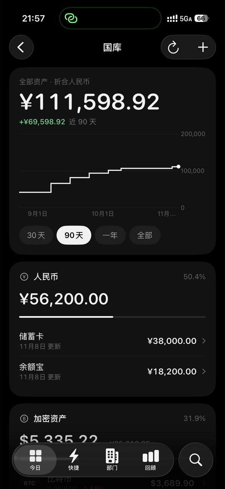
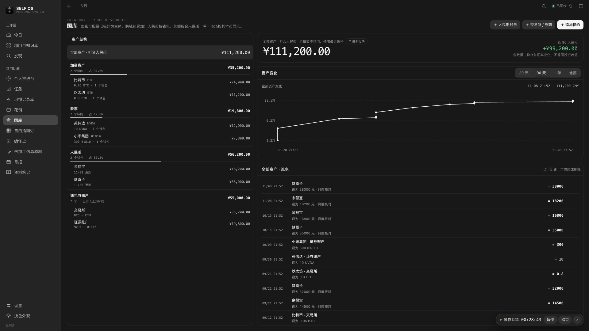
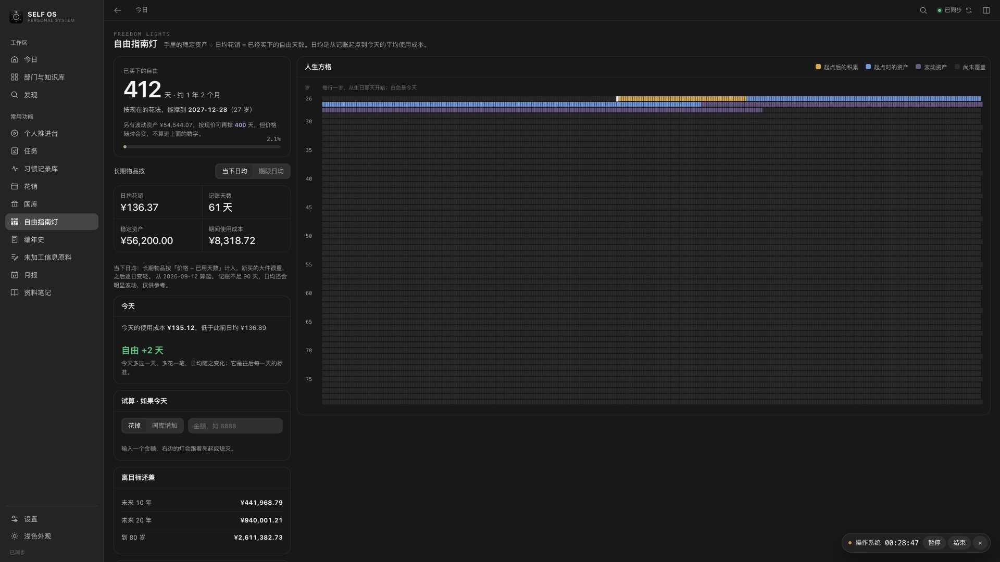

<p align="center"></p>
<h1 align="center">SELF OS</h1>
<p align="center">一个人的操作系统：把任务、习惯、花销、资产、记录放进同一个地方。<br>网页 + iPhone，数据在你自己的服务器上，离线也能用。</p>



## 它能做什么

| 功能 | 说明 |
| --- | --- |
| **今日** | 一页看到今天：正在计时的事、待办、习惯打卡、今日花销、随手记录 |
| **个人推进台** | 按「领域 → 子领域 → 问题 → 方案」推进长期目标，计时并记录每一步进展，看近半年的节奏 |
| **任务** | 今天做、最近做、截止日期、时间段，几种排期方式 |
| **习惯** | 打卡、计数、清单三种习惯；清单里的每一项可以单独看坚持情况 |
| **花销** | 日常记账；手机、电脑这类大件按天摊销，知道每天真正的使用成本 |
| **国库** | 管理资产：人民币按钱包，加密货币和股票按标的跨账户合计，实时行情折算 |
| **自由指南灯** | 手里的钱 ÷ 日均花销 = 已经买下的自由天数，用一张人生方格图展示 |
| **记录** | 编年史（每天发生了什么）、想法暂存、资料笔记、月报、每日指标、重要日子 |

<p>
  
  
  
</p>




截图里都是演示数据。

## 特点

- **数据是你自己的。** 部署在你自己的服务器上，没有第三方账号，也不上传到任何别的地方。
- **离线可用。** 网页和手机都先把内容存在本机，有网时自动同步；两端同时改了同一条会提示你选择。
- **手机和电脑是同一套数据。** 一端改动，另一端几秒内跟上。
- **设备靠配对码连接。** 在服务器上生成一次性连接码，输入后设备才有权限；随时可以撤销某台设备。
- **每天自动备份，并验证备份能恢复。**

## 在自己电脑上试用

需要 [Node.js 24](https://nodejs.org) 和 [Docker](https://www.docker.com/products/docker-desktop/)。

```bash
git clone https://github.com/YouMingKaMi/SELF_OS_public.git
cd SELF_OS_public
npm ci
docker compose -f infra/compose.yaml up -d   # 启动本机数据库
npm run seed                                  # 可选：放入一些演示数据
npm run dev                                   # 构建并启动
```

打开 http://127.0.0.1:8900 就能用了。这是本机试用模式，不需要配对，数据存在本机的 Docker 数据库里。

## 正式使用

- **部署到自己的服务器**（一台最低配的云服务器就够）：见 [docs/deploy.md](docs/deploy.md)
- **安装 iPhone App**（需要一台 Mac 和 Xcode）：见 [docs/iphone.md](docs/iphone.md)
- **想了解或修改代码**：见 [docs/architecture.md](docs/architecture.md)

## 现在的状态

这是作者自己每天在用的系统，功能完整但偏个人化，例如默认部门叫「执行部 / 财政部 / 档案库 / 中科院」，界面只有中文。还没有做的：

- iPhone App 没有上架，需要自己用 Xcode 安装；免费 Apple 账号签名的 App 每 7 天要重装一次。
- 没有安卓版（手机浏览器可以直接用网页版）。
- 只支持单人使用，没有多人协作。
- 笔记里暂时不能放图片和附件。

欢迎提 Issue 和 PR。

## 许可

[MIT](LICENSE)
