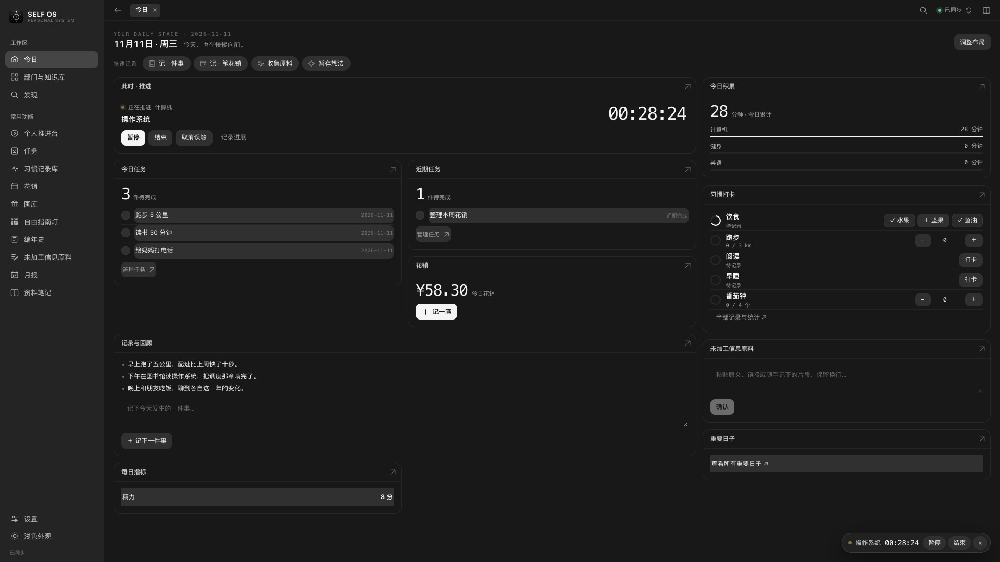
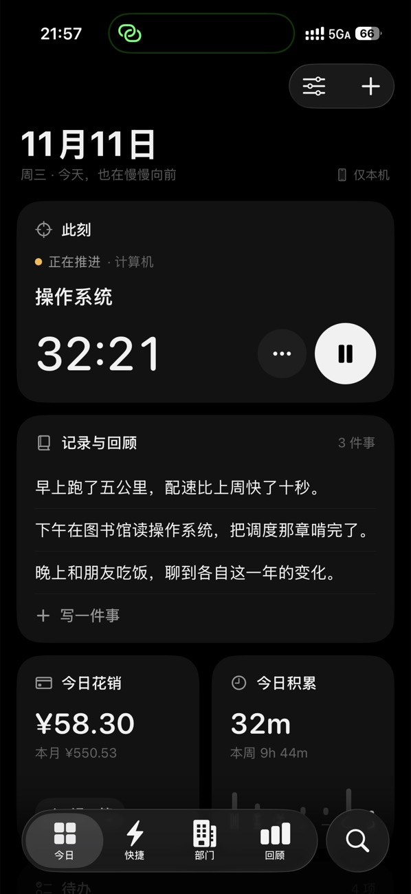
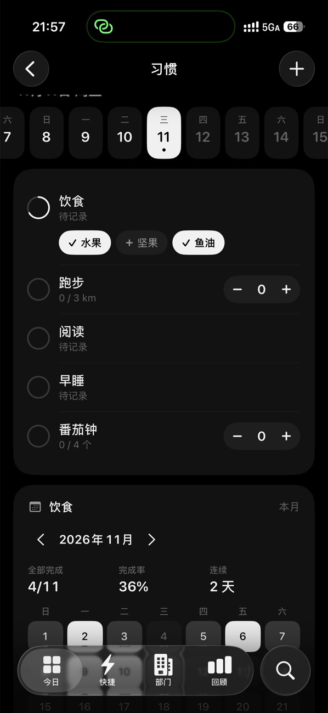
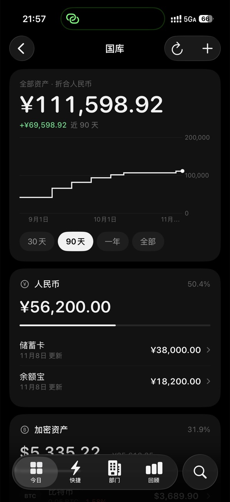
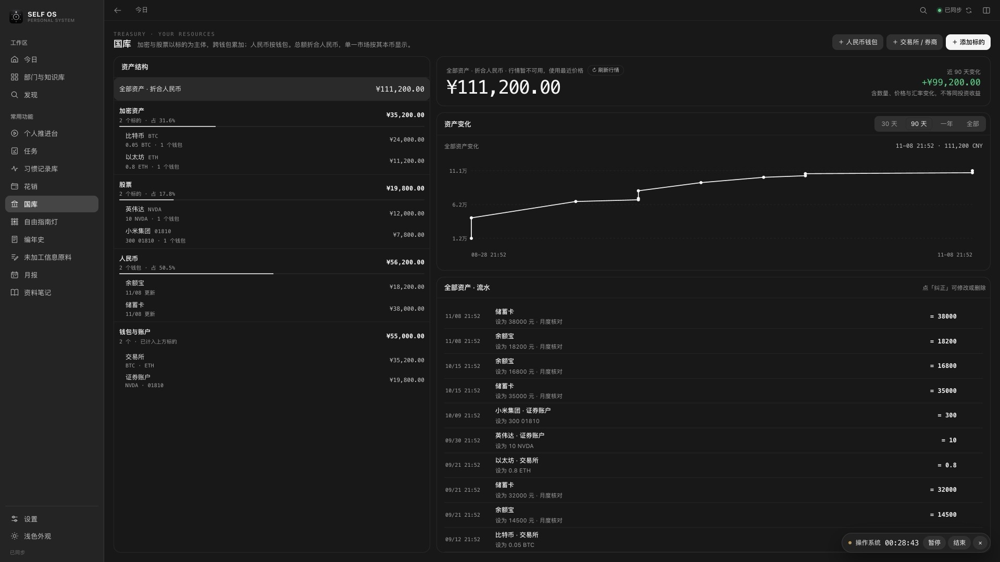
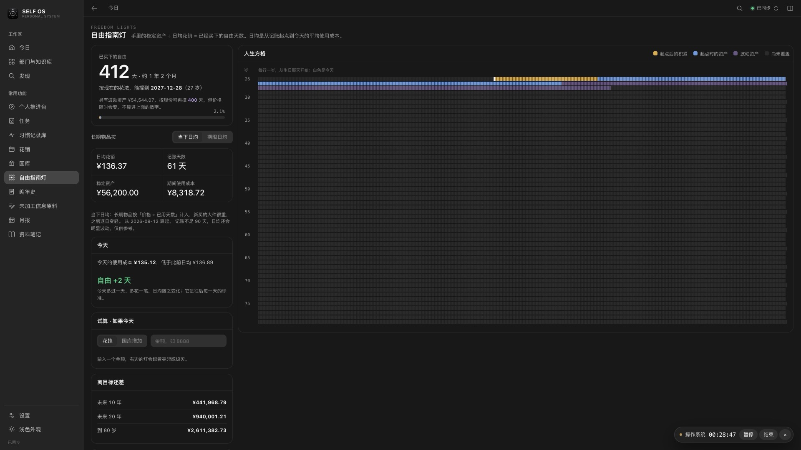

<p align="center"></p>
<h1 align="center">SELF OS</h1>
<p align="center">一个人的操作系统：把推进、任务、习惯、花销、资产、储物箱与长期记录放进同一个地方。<br>网页 + macOS 桌面客户端 + iPhone 原生端（含桌面小组件） + Android APK，数据在你自己的服务器上，离线也能用。</p>



## 它能做什么

| 功能 | 说明 |
| --- | --- |
| **今日** | 一页看到今天：正在计时的事、待办、习惯打卡、今日花销、随手记录、重要日子与指标 |
| **个人推进台** | 按「领域 → 子领域 → 问题 → 方案」推进长期目标，计时并记录每一步进展，看近半年的节奏 |
| **任务与清单** | 今天做、最近做、截止日期、时间段、无日期五种排期；支持前置依赖、批量整理与准备清单 |
| **习惯** | 打卡、计数、清单三种习惯；规则版本历史、月历，清单里的每一项可单独看坚持情况 |
| **花销** | 日常记账；手机、电脑这类大件按天摊销与出售回收结算，知道每天真正的使用成本；可选从 Mac 微信支付通知导入 |
| **国库** | 管理资产：人民币按钱包，加密货币和美股 / 港股 / A 股按标的跨账户合计，实时行情折算与历史曲线 |
| **自由指南灯** | 手里的钱 ÷ 日均花销 = 已经买下的自由天数，用一张人生方格图与趋势曲线展示 |
| **储物箱** | 像 MC 箱子一样记录实体物品位置：支持箱内分区/子箱、180 枚纯黑白线框图标（Web Lucide + iOS SF Symbols）、取出提醒、一键归位，以及手机端相册式多选与拖拽整理 |
| **记录、回忆录与成就** | 编年史、回忆录（人生阶段回忆）、想法暂存、未加工原料、Markdown 资料笔记（含全文搜索与流式导出）、月报、每日指标、双历法重要日子与里程碑成就 |
| **工作区与模块定制** | 跨端自动同步的工作区配置（`workspaceConfig`）：内置三套预设，支持按需隐藏模块、自定义任意模块和内置部门名称，以及配置 JSON 导入/导出 |

<p>
  
  
  
</p>




截图里都是演示数据。

## 灵活工作区定制（跨端自动同步）

SELF OS 默认保留完整的「个人内阁」19 个功能模块与默认命名；同时为了适配不同人的使用习惯，在 **设置 → 工作区与模块定制**（Web / macOS 与 iPhone 跨端自动同步）可以随时调整：

- **三套预设一键切换**：**个人内阁**（全 19 项开启）、**常规生活**（精选 9 项：任务、习惯、花销、编年史、想法、笔记、重要日子、储物箱、成就）、**极简起步**（核心 5 项：任务、习惯、花销、编年史、笔记）；全新空白工作区的首页也会直接提供一键选型入口。
- **按需开关模块（不丢数据）**：隐藏不需要的模块后，侧边栏、导航、首页卡片与手机快捷入口会自动收起，数据本身原封不动，随时重新打开。
- **自定义模块与部门名称**：默认名称保持不变，但任意模块和 4 个内置部门（执行部 / 财政部 / 档案库 / 中科院）都支持自定义显示名，不需要的内置部门也可以隐藏。
- **配置导出 / 导入**：Web 端支持将工作区定制导出为 JSON 备份或导入复用。

## 特点

- **数据是你自己的。** 部署在你自己的服务器上，没有第三方账号，也不上传到任何别的地方。
- **离线可用。** 网页和手机都先把内容存在本机，有网时自动同步；两端同时改了同一条会提示你选择。
- **全端一套数据。** Web、macOS 桌面端和 iPhone 端共享同一套同步流，一端改动、另一端几秒内跟上。
- **设备靠配对码连接。** 在服务器上生成一次性连接码，输入后设备才有权限；随时可以撤销某台设备。
- **每天自动备份，并验证备份能恢复。** 支持容量与存活监测（[docs/MONITORING.md](docs/MONITORING.md)）与完整灾备恢复（[docs/RECOVERY.md](docs/RECOVERY.md)）。

## 在自己电脑上试用

需要 [Node.js 24](https://nodejs.org) 和 [Docker](https://www.docker.com/products/docker-desktop/)。

```bash
git clone https://github.com/YouMingKaMi/SELF_OS_public.git
cd SELF_OS_public
npm ci
docker compose -f infra/compose.yaml up -d   # 启动本机数据库
npm run seed                                  # 可选：放入一些演示数据
npm run dev                                   # 构建并启动
```

打开 http://127.0.0.1:8900 就能用了。这是本机试用模式，不需要配对，数据存在本机的 Docker 数据库里。

## 正式使用

- **部署到自己的服务器**（一台最低配的云服务器就够）：见 [docs/deploy.md](docs/deploy.md)
- **安装 macOS 桌面客户端**（可选）：在项目根目录运行 `sh scripts/build-macos-app.sh`（自动读取 `infra/deploy/site.env` 或传入 `SELF_OS_URL`，构建并安装 `/Applications/SELF OS.app`）
- **安装 iPhone App（含今日任务小组件）**（需要一台 Mac 和 Xcode）：见 [docs/iphone.md](docs/iphone.md)；免费 Apple 账号可启用 Mac 无线自动续签，见 [docs/iphone-signing.md](docs/iphone-signing.md)
- **安装 / 构建 Android APK（早期测试版）**：可前往 [GitHub Releases](https://github.com/YouMingKaMi/SELF_OS_public/releases) 直接下载通用版 APK（⚠️ 早期版本可能存在较多问题，作者尚未仔细体验研究，仅供尝鲜），或按 [docs/android.md](docs/android.md) 自行构建
- **想了解或修改代码**：见 [docs/architecture.md](docs/architecture.md)

### 可选：微信支付记账（仅 macOS）

如果你在 Mac 上已经配置了 `wechat-cli`，可以从微信支付公众号通知里读取付款并导入 SELF OS；商户用途可以记住，未分类的付款会进入「待分类」。工具只在本机运行，数据只发送到你自己的 SELF OS 地址。安装和隐私说明见 [tools/wechat-pay/README.md](tools/wechat-pay/README.md)。

### iPhone 今日任务小组件

CouncilStudio 工程包含一个今日任务小组件：在桌面查看今天和明天的任务，点击完成会先排队，下次打开 App 时校验并同步。小组件会在桌面/锁屏显示任务标题；如果任务标题敏感，请不要把小组件放到锁屏。安装说明见 [docs/iphone.md](docs/iphone.md)。

## 现在的状态

这是作者自己每天在用的完整版本，现在已与个人仓库同步统一，并通过跨端「工作区与模块定制」让所有人都能按自己的方式裁剪功能、重命名模块和部门。目前仍需了解的限制：

- 界面目前只有中文（支持通过自定义名称修改模块与部门显示名）。
- iPhone App 没有上架 App Store，需要用 Mac + Xcode 自行安装；免费 Apple 账号签名的 App 每 7 天需要续签（仓库已附带 Mac 无线自动续签脚本）。
- Android 端为原生 Kotlin 安全壳 APK（`apps/android/`），默认不内嵌服务器地址，可在 [GitHub Releases](https://github.com/YouMingKaMi/SELF_OS_public/releases) 下载或自行运行 `sh scripts/build-android-apk.sh` 构建（⚠️ 当前为早期测试版，可能出现较多问题，作者尚未仔细体验研究，详见 [docs/android.md](docs/android.md)）。
- 只支持单人使用，没有多人协作。
- 笔记里暂时不能放图片和附件。
- 微信支付导入需要 Mac 上另装 `wechat-cli`；它不是 SELF OS 的依赖，没装也不影响记账。

欢迎提 Issue 和 PR。

## 许可

[MIT](LICENSE)
